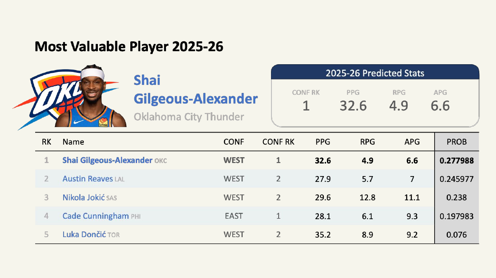
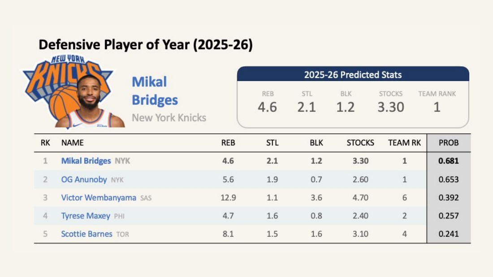
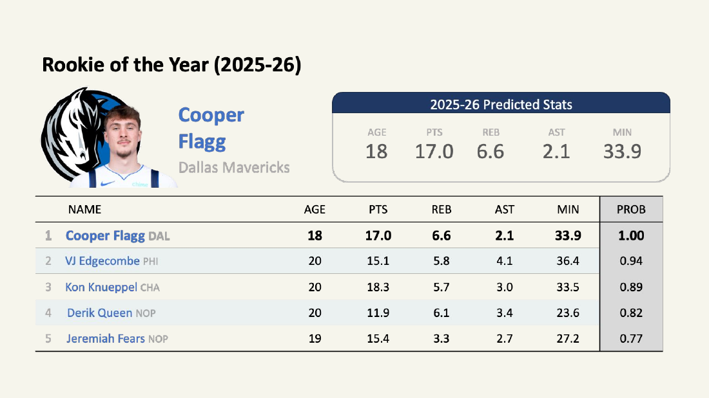
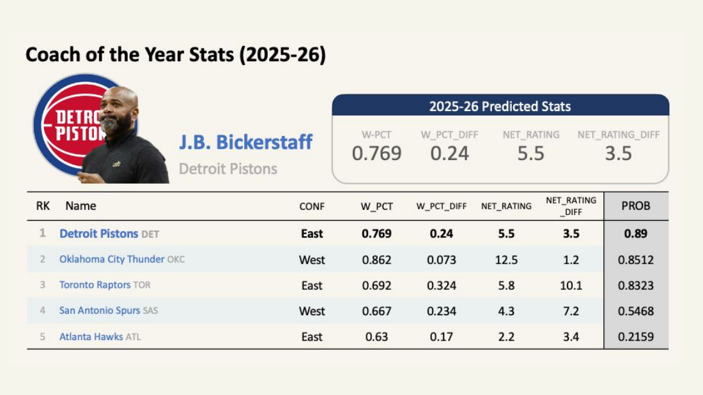
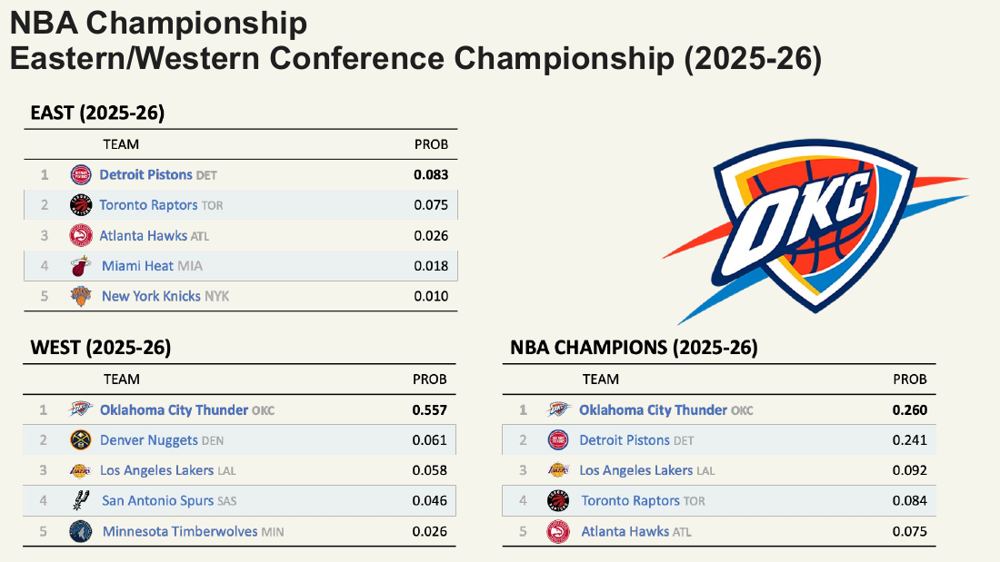
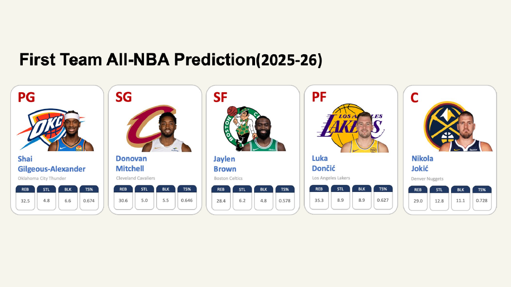

# 2025-26 NBA Awards Prediction Model

**Daily-updating models that predict the 2025-26 NBA award winners from live NBA Stats data.**

The awards covered are MVP, Defensive Player of the Year, Rookie of the Year, Coach of the Year, All-NBA First Team, and the conference and NBA champions. Each model pulls current-season stats through [`nba_api`](https://github.com/swar/nba_api), scores every eligible player or team, and writes a date-stamped prediction file, so the race can be tracked through the season.

MGTA 452 · UC San Diego, Rady School of Management · Damilare Shonuyi & Jeongeun Park



---

## Predictions (as of Dec 3, 2025)

| Award | Predicted winner | Runner-up |
|---|---|---|
| **MVP** | Shai Gilgeous-Alexander (OKC), 27.8% | Austin Reaves (LAL), 24.6% |
| **Defensive Player of the Year** | Mikal Bridges (NYK), 0.68 | OG Anunoby (NYK), 0.65 |
| **Rookie of the Year** | Cooper Flagg (DAL), 1.00 | VJ Edgecombe (PHI), 0.94 |
| **Coach of the Year** | J.B. Bickerstaff (DET), 0.89 | Mark Daigneault (OKC), 0.85 |
| **East champion** | Detroit Pistons | Toronto Raptors |
| **West champion** | Oklahoma City Thunder | Denver Nuggets |
| **NBA champion** | Oklahoma City Thunder, 26.0% | Detroit Pistons, 24.1% |
| **All-NBA First Team** | SGA · Donovan Mitchell · Jaylen Brown · Luka Dončić · Nikola Jokić | |

Full slides are in [`docs/nba_awards_prediction_presentation.pdf`](docs/nba_awards_prediction_presentation.pdf).

## Approach

Each award starts from a **profile of the last five winners**: what they had in common statistically. That profile filters the candidate pool to realistic contenders before a model scores them.

| Award | Winner profile (last 5 seasons) | Model |
|---|---|---|
| **MVP** | 26+ PPG, top-3 seed in conference, 52+ team wins | **Random forest** trained on every player-season from 2010-11 to 2023-24 (PPG, RPG, APG, +/-, team wins, conference rank), with a stratified split for the extreme class imbalance (1 winner per ~500 players) |
| **DPOY** | Top-10 team defense, 28+ MPG, 2+ stocks, 3.5+ RPG | **Logistic regression** on blocks, steals, rebounds, stocks and inverse team defensive rank, trained on past DPOY races. Retries with exponential backoff on API timeouts |
| **ROY** | Age ≤ 20, 15+ PPG, 6'7"+, non-playoff team | **Weighted z-score index**: points, rebounds, assists, stocks, minutes, a usage proxy and a box-score impact score, min-max scaled to 0–1 |
| **Conference & NBA champion** | — | **Logistic regression** (class-balanced) on base + advanced team stats from 2014-15 to 2023-24, validated with **leave-one-season-out** cross-validation. Adjusted for roster continuity, last season's playoff results and finalists, then constrained so each conference produces one finalist |
| **COY** | Win% ≥ .650, net rating ≥ +5, year-over-year jumps in win% (+.15) and net rating (+2.5) | Logistic regression on W%, net rating and their year-over-year changes, with leave-one-season-out CV |
| **All-NBA 1st Team** | — | Logistic regression on player stats, then the top-probability player at each position group |

*The COY and All-NBA notebooks aren't in this repo yet. Their methods and results are in the presentation.*

### Daily pipeline

```
nba_api (live NBA Stats)  →  feature build  →  profile filters  →  model scoring  →  dated CSV snapshot
```

Every notebook can be rerun on any day to refresh its predictions. The DPOY model also keeps a running log (`dpoy_daily_log.csv`) to show how the race moves over time.

## Results by award

| MVP | Defensive Player of the Year |
|---|---|
|  |  |
| **Rookie of the Year** | **Coach of the Year** |
|  |  |
| **Conference & NBA Champions** | **All-NBA First Team** |
|  |  |

## Repository structure

```
├── notebooks/
│   ├── mvp.ipynb            # MVP: historical data build, random forest, daily ranking
│   ├── dpoy.ipynb           # DPOY: logistic model + daily snapshot/log
│   ├── roy.ipynb            # ROY: rookie scoring index
│   └── championship.ipynb   # East / West / NBA champion models
├── docs/
│   └── nba_awards_prediction_presentation.pdf
├── images/                  # result slides used in this README
└── requirements.txt
```

## Running it

```bash
pip install -r requirements.txt
jupyter notebook notebooks/
```

Open a notebook and run all cells. The first run pulls historical seasons from the NBA Stats API, which takes several minutes because requests are rate-limited. Later runs reuse the cached CSVs and trained models. Generated data, models and daily predictions are written next to the notebooks and are git-ignored.

## Tech stack

Python · nba_api · pandas · NumPy · scikit-learn (random forest, logistic regression, leave-one-group-out CV) · joblib · Jupyter
